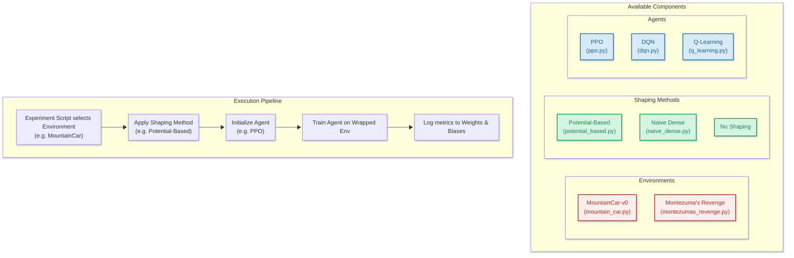

# 📈 ShapingRL

Reward Shaping and Potential-Based Methods in Reinforcement Learning

## 📚 Project Overview

**Course:** Reinforcement Learning  
**Topic:** Reward Shaping and Potential-Based Methods

### Objectives

Compare naïve dense shaping against potential-based shaping across sparse-reward tasks to identify when shaping accelerates learning versus when it biases policies.

### Tasks

- Implement standard RL algorithms (Q-learning, PPO, DQN) on sparse-reward tasks (MountainCar, Atari Montezuma's Revenge)
- Compare naive reward shaping (dense rewards, penalties) with potential-based shaping
- Study the impact on convergence, exploration, and policy optimality
- Analyze sensitivity to mis-specified shaping potentials
- Provide guidelines: When is shaping helpful, harmful, or unnecessary?

### References

1. [Ng, Andrew Y., Daishi Harada, and Stuart Russell. "Policy invariance under reward transformations: Theory and application to reward shaping." ICML 1999.](https://people.eecs.berkeley.edu/~russell/papers/icml99-shaping.pdf)
2. [Razin, Noam, et al. "What makes a reward model a good teacher? an optimization perspective." arXiv preprint arXiv:2503.15477 (2025).](https://arxiv.org/pdf/2503.15477)
3. [Ma, Haozhe, et al. "Reward shaping for reinforcement learning with an assistant reward agent." Forty-first international conference on machine learning. 2024.](https://dl.acm.org/doi/10.5555/3692070.3693450)

---

## 🏗️ Repository Structure

```text
ShapingRL/
├── src/                          # Source code
│   ├── agents/                   # RL algorithm implementations
│   │   ├── q_learning.py        # Tabular Q-Learning
│   │   ├── dqn.py               # Deep Q-Network
│   │   └── ppo.py               # Proximal Policy Optimization
│   ├── core/                     # Core utilities
│   │   ├── config.py            # Configuration settings
│   │   ├── logger.py            # Logging utilities
│   │   ├── seeds.py             # Seed management
│   │   └── wandb_callback.py   # Weights & Biases integration
│   ├── environments/             # Environment wrappers
│   │   ├── mountain_car.py      # MountainCar environment wrapper
│   │   └── montezumas_revenge.py # Montezuma's Revenge environment wrapper
│   ├── shaping/                  # Reward shaping methods
│   │   ├── mountain_car/        # MountainCar shaping methods
│   │   │   ├── naive.py         # Naive dense reward shaping
│   │   │   └── potential.py     # Potential-based reward shaping
│   │   └── montezuma/           # Montezuma's Revenge shaping methods
│   │       ├── naive.py         # Naive dense reward shaping
│   │       ├── potential.py     # Potential-based reward shaping
│   │       └── grid_based.py    # Grid-based shaping
│   ├── training/                 # Training utilities
│   │   ├── coach.py             # Guideline coach implementation
│   │   └── guide.py             # Guideline definitions
│   ├── info/                     # Information extraction
│   ├── information_extraction/   # Information extraction utilities
│   ├── log/                      # Logging utilities
│   └── util.py                   # General utilities
├── tests/                        # Unit tests
│   ├── test_benchmark.py        # Benchmark tests
│   ├── test_dependencies.py     # Dependency tests
│   ├── test_mc.py               # MountainCar tests
│   └── test_mr.py               # Montezuma's Revenge tests
├── notebooks/                    # Jupyter notebooks for experiments
│   └── exploratory_analysis.ipynb
├── flake.nix                    # Nix flake for reproducible dev environment
└── requirements.txt             # Pip requirements file
```

---

## 🎯 Usage

### Running Experiments

```bash
# MountainCar environment
python src/environments/mountain_car.py --agent=ppo --shaping=potential --timesteps=10000
python src/environments/mountain_car.py --agent=dqn --shaping=naive --timesteps=5000
python src/environments/mountain_car.py --agent=q-learning --shaping=none --timesteps=2000

# Montezuma's Revenge environment
python src/environments/montezumas_revenge.py --agent=ppo --shaping=potential --timesteps=100000
```

### Development

```bash
# Run tests
pytest

# Run specific test files
pytest tests/test_mc.py
pytest tests/test_mr.py
pytest tests/test_benchmark.py

# Format code
ruff format src/

# Run linter
ruff check src/
```

## Architecture



---

## 📦 Dependencies

### Core Dependencies

- **torch** - Deep learning framework (DQN, PPO)
- **gymnasium** - RL environments (MountainCar, Atari)
- **ale-py** - Atari Learning Environment
- **pygame** - Environment rendering
- **numpy** - Scientific computing
- **matplotlib** - Visualization
- **opencv-python** - Image processing (for Montezuma's Revenge test wrapper)
- **jupyter** - Interactive notebooks
- **wandb** - Experiment tracking and logging
- **stable-baselines3** - RL algorithm implementations

### Development Tools

- **pytest** - Testing framework
- **ruff** - Code formatting and linting

### Additional Dependencies

- **imageio**, **imageio-ffmpeg**, **moviepy**, **pillow** - Video recording for wandb

See `requirements.txt` or `flake.nix` for complete dependency list with versions.

---

## 👥 Team

- Björn Brauer
- Leandro Gregorini
- Flavio Kluser
- Alexandru Schneider
- Roman Zberg
