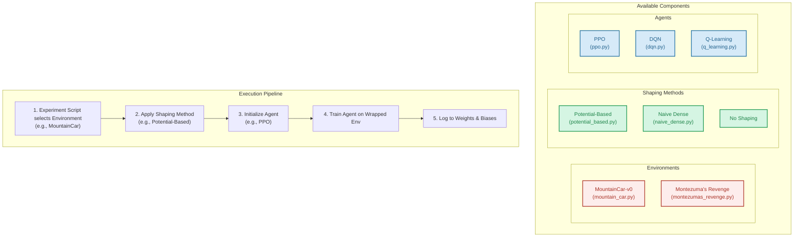

# ShapingRL

Reward Shaping and Potential-Based Methods in Reinforcement Learning

This repository contains the implementation and experiments for our university project comparing naive dense reward shaping against potential-based shaping methods in Reinforcement Learning.

## 📚 Project Overview

**Course:** Reinforcement Learning  
**Topic:** Reward Shaping and Potential-Based Methods

### Objectives

Compare naïve dense shaping against potential-based shaping across sparse-reward tasks to identify when shaping accelerates learning versus when it biases policies.

### Tasks
https://docs.google.com/document/d/1xXon4ktpAdHPizVb3PvXX6tmJmtjUxi2Wyn-aixLfps/edit?tab=t.0
- Implement standard RL algorithms (Q-learning, PPO, DQN) on sparse-reward tasks (MountainCar, Atari Montezuma's Revenge)
- Compare naive reward shaping (dense rewards, penalties) with potential-based shaping
- Study the impact on convergence, exploration, and policy optimality
- Analyze sensitivity to mis-specified shaping potentials
- Provide guidelines: When is shaping helpful, harmful, or unnecessary?

### Get Environment
Conda:
```cmd
conda create -n ShapingRL python=3.13 -y
conda activate ShapingRL
pip install -r requirements.txt
```

### References

1. [Ng, Andrew Y., Daishi Harada, and Stuart Russell. "Policy invariance under reward transformations: Theory and application to reward shaping." ICML 1999.](https://people.eecs.berkeley.edu/~russell/papers/icml99-shaping.pdf)
2. [Razin, Noam, et al. "What makes a reward model a good teacher? an optimization perspective." arXiv preprint arXiv:2503.15477 (2025).](https://arxiv.org/pdf/2503.15477)
3. [Ma, Haozhe, et al. "Reward shaping for reinforcement learning with an assistant reward agent." Forty-first international conference on machine learning. 2024.](https://dl.acm.org/doi/10.5555/3692070.3693450)

---

## 🏗️ Repository Structure

```
ShapingRL/
├── src/                          # Source code
│   ├── agents/                   # RL algorithm implementations
│   │   ├── q_learning.py        # Tabular Q-Learning
│   │   ├── dqn.py               # Deep Q-Network
│   │   └── ppo.py               # Proximal Policy Optimization
│   ├── core/                     # Core utilities
│   │   └── replay_buffer.py     # Experience replay buffer
│   ├── environments/             # Environment wrappers
│   │   └── mountain_car.py      # MountainCar environment wrapper
│   │   └── montezumas_revenge.py   # MountainCar environment wrapper
│   └── shaping/                  # Reward shaping methods
│       ├── naive_dense.py       # Naive dense reward shaping
│       └── potential_based.py   # Potential-based reward shaping
├── tests/                        # Unit tests
├── notebooks/                    # Jupyter notebooks for experiments
│   └── exploratory_analysis.ipynb
├── flake.nix                    # Nix flake for reproducible dev environment
├── pyproject.toml               # Python project metadata and dependencies
├── requirements.txt             # Pip requirements file
├── environment.yml              # Conda environment file
└── CONTRIBUTING.md              # Contributing guidelines
```

---

## 🚀 Quick Start

### Option 1: Using Nix (Recommended)

Nix provides a fully reproducible development environment that works identically across all systems.

#### Prerequisites

**Install Nix:**

Visit [nixos.org/download](https://nixos.org/download/) for the latest installation instructions, or follow the quick guide below:

**Linux & macOS:**
```bash
sh <(curl -L https://nixos.org/nix/install) --daemon
```

**Windows (WSL2):**
1. Install WSL2 if not already installed:
   ```powershell
   wsl --install
   ```
2. Open Ubuntu from WSL and install Nix:
   ```bash
   sh <(curl -L https://nixos.org/nix/install) --daemon
   ```

**Docker:**
```bash
docker run -it nixos/nix
```

**Enable flakes:**
```bash
mkdir -p ~/.config/nix
echo "experimental-features = nix-command flakes" >> ~/.config/nix/nix.conf
```

#### Get Started

1. **Clone and enter the environment:**
   ```bash
   git clone https://github.com/btwbrauer/ShapingRL.git
   cd ShapingRL
   nix develop
   ```

2. **Start working:**
   ```bash
   # Launch Jupyter
   jupyter notebook
   
   # Or run scripts directly
   python src/agents/q_learning.py
   
   # Run tests
   pytest
   ```

#### GPU Support

The flake **automatically detects** your GPU and installs the appropriate PyTorch:

- **AMD GPU (Linux):** Automatically uses `torchWithRocm`
- **NVIDIA GPU (Linux):** Use `nix develop .#cuda` for CUDA support
- **macOS:** Automatically uses `torch` with Metal acceleration
- **No GPU:** Falls back to CPU-only PyTorch

The default `nix develop` command detects your hardware at runtime!

### Option 2: Using Pip/Conda

For users who prefer traditional Python tools:

#### Using pip

> ⚠️ Disclaimer for **macOS apple silicon** installations
> 
> You may encounter a `hint: This error likely indicates that you need to install a library that provides "SDL.h" ...` error while installing the package pygame@2.6.1 on macOS. Several Stackoverflow posts and the official documentation (https://www.pygame.org/wiki/MacCompile) suggest installing some arbitrary sdl packages with brew to fix the compilation. Do not even bother as some of these packages don't even exist anymore and newer versions don't work. **Just use conda.**

1. **Setup:**
   ```bash
   git clone https://github.com/btwbrauer/ShapingRL.git
   cd ShapingRL
   python3 -m venv .venv
   source .venv/bin/activate  # On Windows: .venv\Scripts\activate
   ```

2. **Install dependencies:**
   ```bash
   # CPU version
   pip install -e .
   
   # For NVIDIA GPU
   pip install torch --index-url https://download.pytorch.org/whl/cu121
   pip install -e .
   
   # For AMD GPU
   pip install torch --index-url https://download.pytorch.org/whl/rocm6.0
   pip install -e .
   ```

#### Using Conda

```bash
git clone https://github.com/btwbrauer/ShapingRL.git
cd ShapingRL
conda env create -f environment.yml
conda activate rl-shaping
```

---

## 🎯 Usage

### Running Experiments

```bash
# Launch Jupyter
jupyter notebook

# Run individual agents
python src/agents/q_learning.py
python src/agents/dqn.py
python src/agents/ppo.py
```

### Development

```bash
# Format code
black src/

# Run linter
flake8 src/

# Run tests
pytest
```

## Architecture



Note: PPO/DQN use `VecEnv/VecNormalize`; Q-Learning interacts with the wrapped env directly. Shaping wrappers log `env_reward`, `shaping_reward`, and `total_reward`.

---

## 📦 Dependencies

Core dependencies include:
- **torch** - Deep learning framework (DQN, PPO)
- **gymnasium** - RL environments (MountainCar, Atari)
- **ale-py** - Atari Learning Environment
- **pygame** - Environment rendering
- **numpy, pandas, scipy** - Scientific computing
- **matplotlib, seaborn** - Visualization
- **jupyter** - Interactive notebooks
- **pytest, black, flake8** - Development tools

See `requirements.txt` or `pyproject.toml` for complete dependency list

---

## 🤝 Contributing

This is a university group project. Team members should:

1. Create feature branches for new work
2. Format code with Black before committing
3. Write tests for new functionality
4. Update documentation as needed

See `CONTRIBUTING.md` for detailed guidelines.

---

## 🔧 Troubleshooting

**Module not found errors:**
- Nix: Ensure you're inside `nix develop`
- Pip: Activate virtual environment and run `pip install -e .`

**Atari ROMs not found:**
- Run: `ale-import-roms --import-from-pkg atari_py.atari_roms`

**GPU not detected:**
- Nix: Change `torchWithRocm` to `torchWithCuda` in `flake.nix` (line 24) for NVIDIA
- Pip/Conda: Install PyTorch with correct GPU support (see setup instructions)
- WSL2: Ensure GPU drivers are installed on Windows host

---

## 👥 Team

- Björn Brauer
- Leandro Gregorini
- Alexandru Schneider
- Flavio Kluser
- Roman Zberg

## 📄 License

MIT License